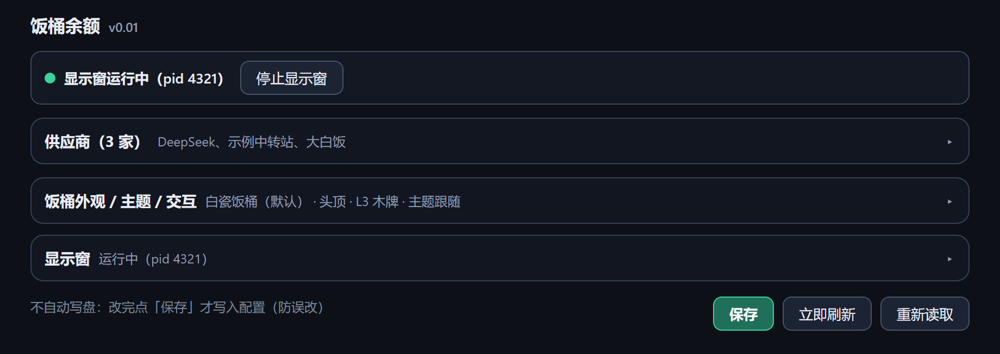
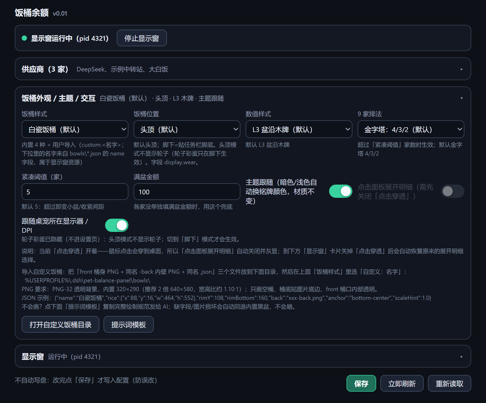
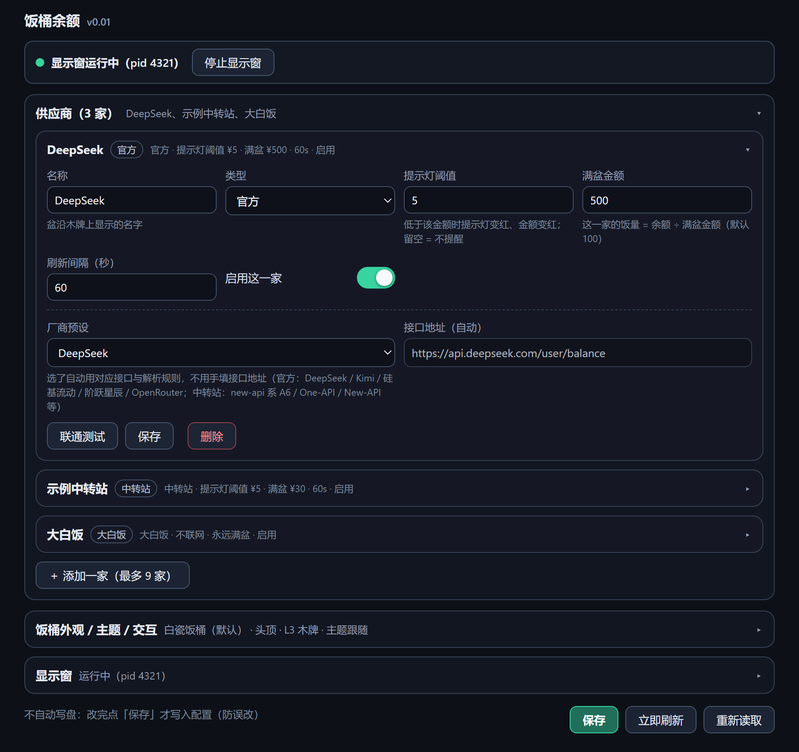
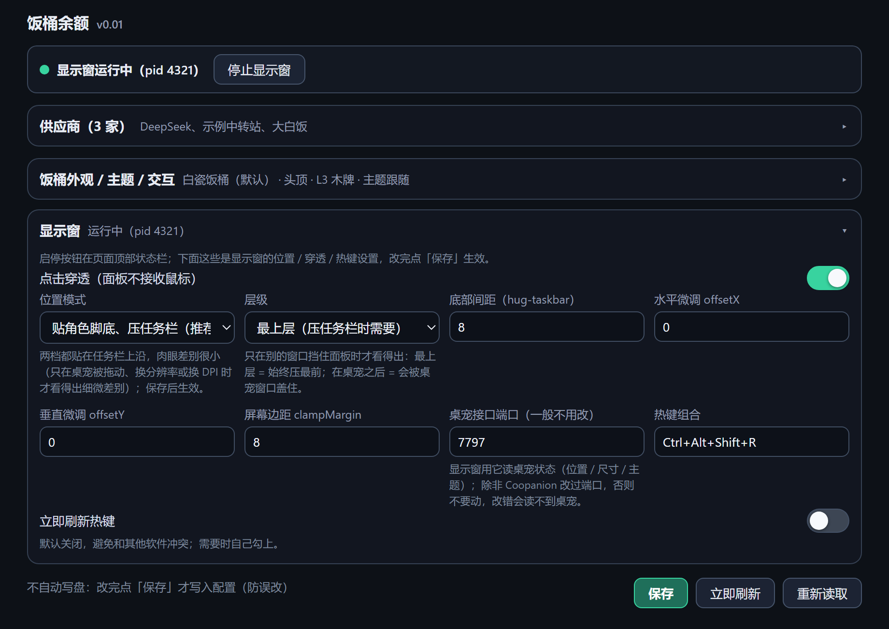
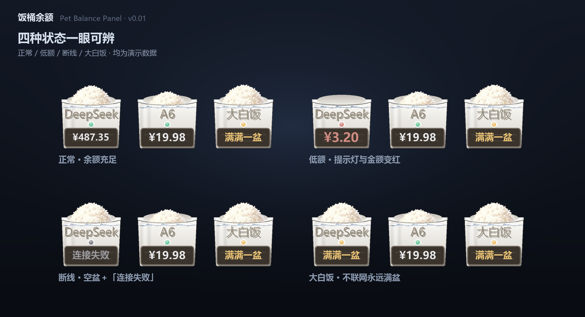
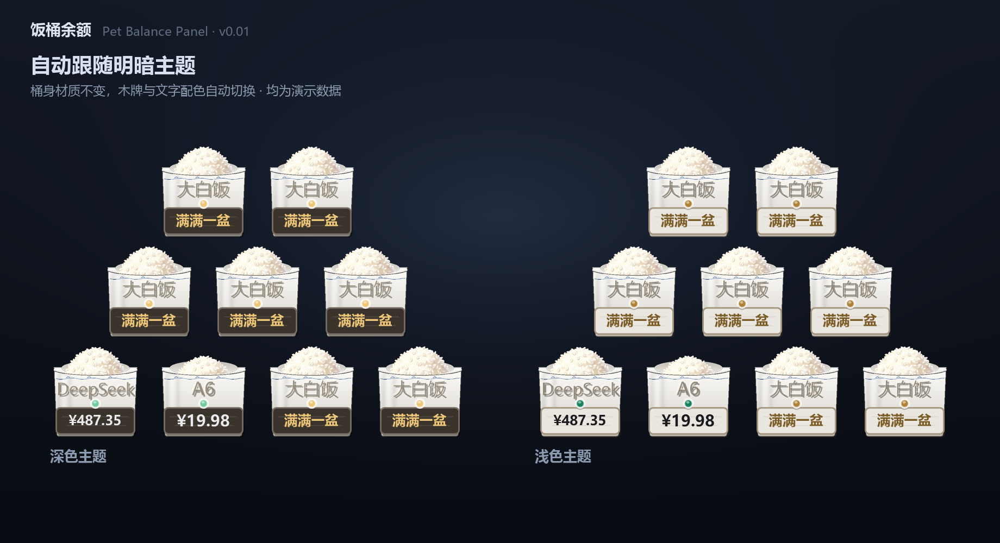

# 饭桶余额 · Rice Bowl Balance

在 Coopanion 桌宠头顶（或脚下）按每家 AI 服务摆一只小饭桶：桶里米饭多少 = 余额还剩多少，一眼看出哪家快见底。

## 关于这个项目

这是一个「零代码」项目：老板没有任何编程经验，也没写过一行代码。从最初的想法、饭桶长什么样，到写代码、调试、打包、写文档，全部由 DeepSeek Harness（DSH）里的两个 AI 伙伴完成——Windows 侧的「墨墨」负责显示窗、Coopanion 扩展、测试与打包，macOS 侧的「麦麦」负责 Mac 端适配与发布。老板只提供了两样东西：灵感思路，和管够的「大白饭」（token）。

## 功能

- **一眼看余额**：每家 AI 服务一只小饭桶，米饭量 = 余额 ÷ 你设的「满盆金额」。低额薄薄一层、中档到桶口、满盆冒出桶沿，还有小绿点 / 红点当提示灯。
- **最多 9 家**：DeepSeek 官方余额接口、new-api 中转站（自动换算额度与汇率）、自定义接口 + JSON 取值路径；另有一档「大白饭」不联网、永远满盆，适合演示。
- **外貌可换**：白瓷 / 黑陶 / 不锈钢 / 复古蓝白搪瓷四款圆柱饭桶，数值样式三款（桶沿小字 / 饭票小旗 / 桶沿木牌）；也能导入自己画的饭桶（设置页内置绘制模板）。
- **跟着桌宠走**：头顶（默认）或脚下两态，随桌宠移动、缩放自动调整，不压任务栏，不抢焦点、不进 Alt+Tab；点击穿透默认开启。
- **9 家排法**：金字塔（默认）/ 一排 / 两排，家数多了自动收紧。
- **手动保存**：改完点「保存」才写入（不自动写盘，防误改）；每家可单独设提示灯阈值与刷新间隔（10–3600 秒）。
- **隐私**：只读余额查询接口，不调用模型、不扣额度、不上报任何数据；密钥由用户在本机自行填写，面板不显示、不修改、不上报。

## 安装（Windows）

1. 在 Coopanion 扩展市场安装并启用「饭桶余额」（本条目为「需另装」类型）。
2. 到本仓库 Releases 下载 Windows 显示窗源码包（`pet-balance-panel-x-0.0.1-源码包.zip`），按包内 `INSTALL.md` 用系统自带的 .NET Framework 4.8 编译，再运行 `install.ps1` 完成安装（装到用户主目录 `.dsh/pet-balance-panel`，写开机自启与开始菜单快捷方式，桌面零文件）。
3. 打开「饭桶余额」设置页，填余额来源，保存后约 5 秒生效。

> 显示窗为源码自建、**未签名**，若出现「Windows 已保护你的电脑」提示属正常，点「更多信息 → 仍要运行」即可。

**前置**：Coopanion 0.2.16+（World API 6）；显示窗目前仅 Windows，配置页在其他平台也能打开。

## 截图

| | |
|---|---|
|  |  |
|  |  |
|  |  |
|  | |

## 更新日志

见 [CHANGELOG.md](CHANGELOG.md)（当前 v0.0.1 首个公开版本）。

## 许可

[MIT](LICENSE)

## 致谢

- [DeepSeek Harness](https://github.com/deepseek-ai) —— 墨墨（Windows）与麦麦（macOS）
- [Coopanion](https://github.com/Pal-AI-Lab/Coopanion) 桌宠
